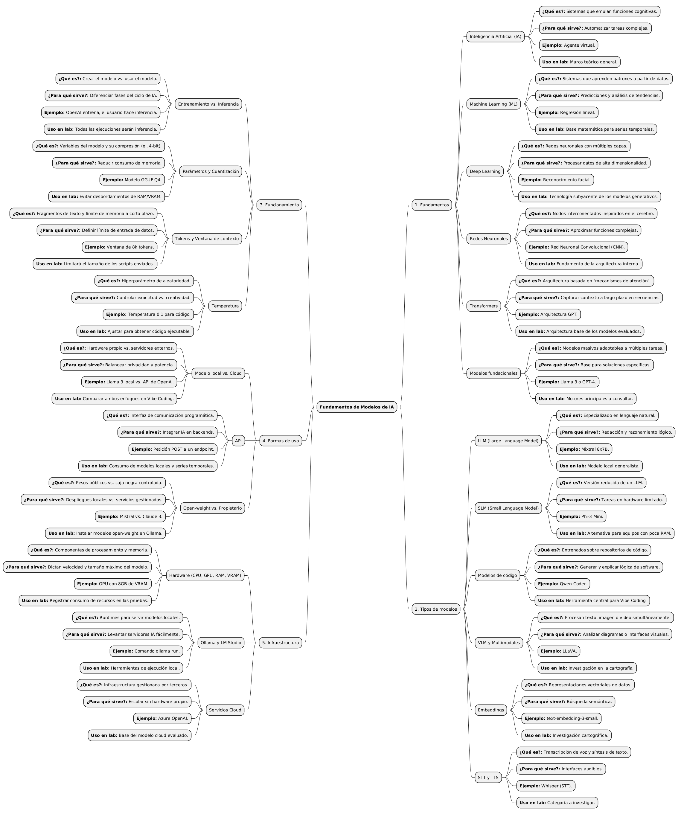
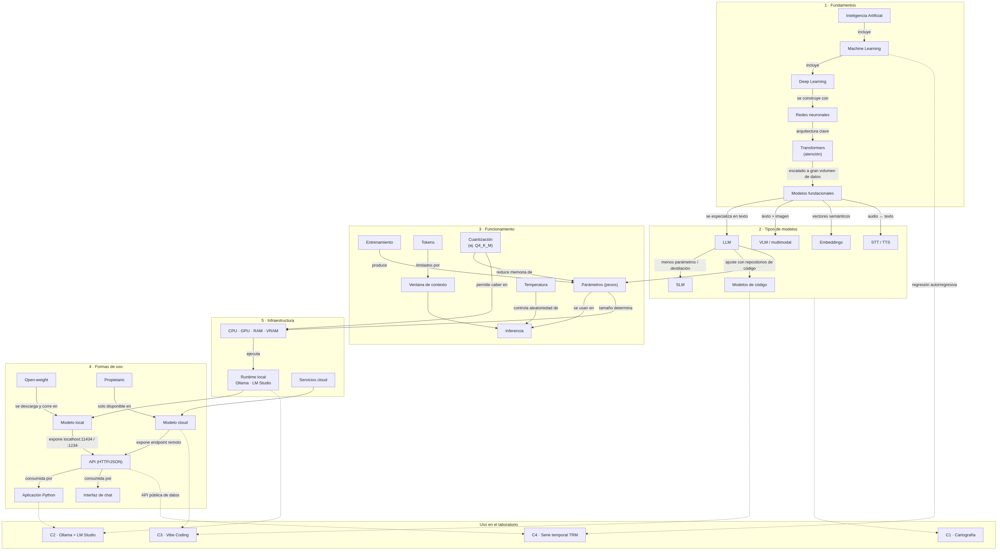

# Componente 0 · Mapa mental: Fundamentos de modelos de IA (15 %)

**Autor:** Juan Diego Varón Valencia · Fundamentos de IA · Universidad de Manizales

El entregable tiene dos vistas complementarias:

| Archivo | Qué muestra |
|---|---|
| `mapamental.png` / `mapamental.puml` | **Jerarquía**: las 5 ramas obligatorias y, para cada concepto, *¿qué es?*, *¿para qué sirve?*, *ejemplo* y *uso en el laboratorio*. Fuente en PlantUML. |
| `relaciones.png` / `relaciones.mmd` | **Relaciones y dependencias** entre conceptos de distintas ramas y en qué componente del laboratorio se usan (un mapa jerárquico por sí solo no muestra estas conexiones). |

## 1. Mapa jerárquico

> Para regenerar la imagen: pegar `mapamental.puml` en <https://www.plantuml.com/plantuml> (o usar la extensión PlantUML de VS Code) y exportar PNG.

## 2. Mapa de relaciones

Relaciones clave que el mapa hace explícitas:

- **IA ⊃ ML ⊃ Deep Learning**: las redes neuronales profundas con arquitectura **Transformer**, entrenadas a gran escala, dan lugar a los **modelos fundacionales**, de los que se derivan LLM, SLM, modelos de código, VLM, embeddings y STT/TTS.
- **Parámetros → hardware**: el número de parámetros y la **cuantización** (p. ej. Q4_K_M) definen cuánta **RAM/VRAM** se necesita; por eso en el Componente 2 se usaron modelos de 7–8B cuantizados a 4 bits (~4.7–4.9 GB).
- **Runtime → API → aplicación**: Ollama/LM Studio cargan el modelo y exponen una **API local** (`localhost:11434` / `localhost:1234`) que consume un programa Python. Es la cadena `MODELO → RUNTIME → API LOCAL → APLICACIÓN` del Componente 2.
- **Open-weight → local / propietario → cloud**: define qué modelos pueden correr en el equipo (Llama, Qwen) y cuáles solo por API (Claude, GPT).
- **Machine Learning clásico → Componente 4**: la predicción de la TRM usa una regresión lineal autorregresiva, no un LLM. La IA generativa se usó para *desarrollar* el código (Vibe Coding), no para *predecir*.

Código Mermaid (GitHub lo renderiza directamente)

Ver [`relaciones.mmd`](relaciones.mmd).

