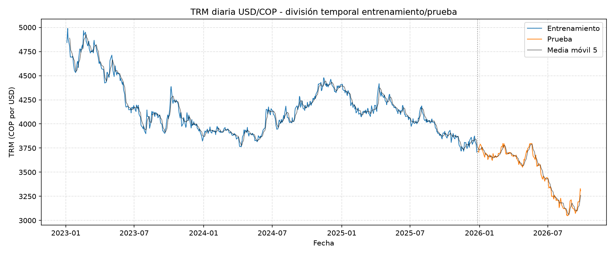
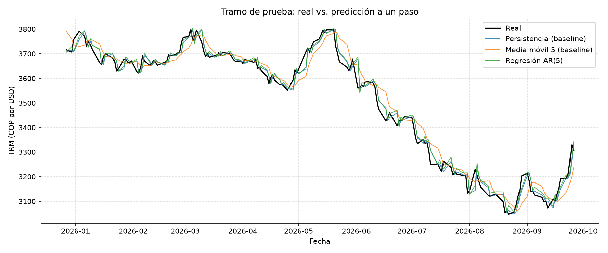
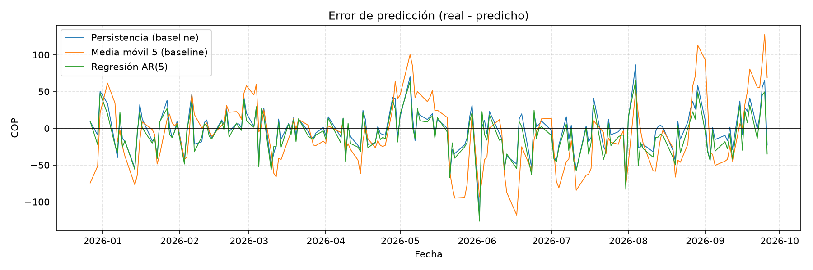
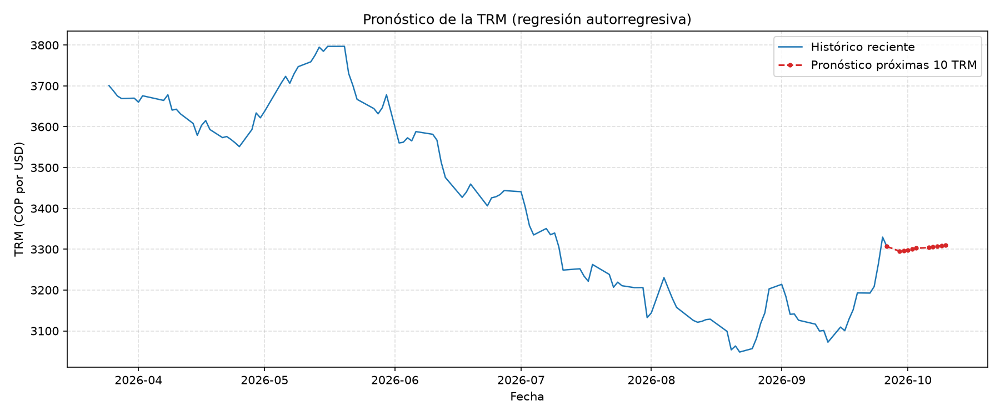

# Componente 4 · Reto integrador: Vibe Coding + API + Series temporales (25 %)

**Autor:** Juan Diego Varón Valencia · Profundización I: IA · Universidad de Manizales

**Problema:** pronosticar la **Tasa Representativa del Mercado (TRM, pesos colombianos por dólar)** del siguiente día hábil a partir de su historia, y evaluar si un modelo sencillo supera a los baselines ingenuos.

```
API Datos Abiertos -> JSON -> Python/Pandas -> Validación y preparación -> Serie temporal
     -> Split temporal train/test -> Baselines + Regresión AR -> Predicción -> MAE/RMSE -> Gráficas
```

## Ejecución

```bash
cd serie_temporal
python app.py                                   # consulta la API: 2023-01-01 hasta hoy
python app.py --inicio 2020-01-01 --horizonte 15
python app.py --offline                         # repite el análisis con el JSON ya descargado (sin red)
```

Parámetros: `--inicio`, `--fin`, `--test-size` (0.2), `--ventana` (5), `--rezagos` (5), `--horizonte` (10), `--offline`.
Pruebas: desde la raíz del repositorio, `python -m pytest -q`.

### Salidas en `serie_temporal/outputs/`

| Archivo | Contenido |
|---|---|
| `trm_raw.json` | Respuesta cruda de la API + metadatos de la consulta (**evidencia de consumo**) |
| `resumen_ejecucion.json` | Parámetros, reporte de calidad, fechas del split, métricas, coeficientes y versiones del entorno |
| `metricas.csv` | MAE, RMSE y MAPE de cada modelo en el tramo de prueba |
| `predicciones_prueba.csv` | Real vs. predicción, día a día |
| `pronostico_futuro.csv` | Pronóstico de las próximas N TRM publicadas |
| `01_serie_train_test.png` … `04_pronostico_futuro.png` | Serie con split, real vs. predicción, errores y pronóstico |

## Ciclo de vida del software

### 1. Requisitos
- **Datos:** TRM diaria oficial en COP/USD de al menos 2–3 años.
- **La aplicación debe mostrar:** la serie histórica, la división entrenamiento/prueba, la comparación real vs. predicción, los errores y el pronóstico.
- **Debe predecir:** la TRM del **siguiente día hábil** (un paso adelante) y un pronóstico indicativo de las próximas 10 TRM.
- **No funcionales:** sin API keys obligatorias ni secretos en el código, reproducible (modo `--offline`) y ejecutable en un portátil.

### 2. Análisis
- **API:** Socrata / Datos Abiertos Colombia, dataset [`32sa-8pi3`](https://www.datos.gov.co/d/32sa-8pi3) ([documentación](https://dev.socrata.com/foundry/www.datos.gov.co/32sa-8pi3)). La fuente original es la Superintendencia Financiera. Es gratuita y no requiere token (un `X-App-Token` opcional sube el límite de peticiones).
- **Estructura:** `valor` (texto → float), `unidad` ("COP"), `vigenciadesde` y `vigenciahasta` (texto ISO → datetime).
- **Restricciones:**
  - La API pagina los resultados (se usan `$limit`/`$offset`) y los devuelve como **texto**, así que hay que convertir los tipos.
  - La TRM se publica en días hábiles. La de un viernes rige hasta el lunes (`vigenciadesde` 19-sep, `vigenciahasta` 21-sep), por eso **no hay valores nuevos en fines de semana ni festivos**.
  - Es una serie financiera muy cercana a una *caminata aleatoria*: el mejor predictor del precio de mañana suele ser el de hoy. Por eso la **persistencia** es un baseline exigente.

### 3. Diseño

| Módulo | Responsabilidad |
|---|---|
| `config.py` | Parámetros y variables de entorno (`.env`) |
| `api_client.py` | Petición HTTP paginada, validación de status/JSON/campos, guardado del JSON crudo |
| `preprocessing.py` | Tipos, faltantes, duplicados, valores ≤ 0, orden temporal, continuidad de vigencias, split temporal |
| `model.py` | Persistencia, media móvil y regresión lineal autorregresiva AR(p) |
| `evaluation.py` | MAE, RMSE, MAPE y gráficas |
| `app.py` | Orquesta el flujo (CLI) y guarda las evidencias |

**Decisiones de diseño:**
- **Una observación por TRM publicada** (día hábil). Si se expandiera a días calendario, los fines de semana repetirían el valor y la persistencia acertaría "gratis", lo que inflaría las métricas.
- **Split temporal 80/20 sin barajar:** todo el tramo de prueba es posterior al de entrenamiento (`assert` explícito en `app.py`).
- **Validación walk-forward a un paso:** para predecir el día *t* solo se usan valores reales hasta *t−1*. El modelo AR se entrena **solo** con el tramo de entrenamiento. Hay una prueba automática que altera el valor del día *t* y comprueba que la predicción de *t* no cambia (sin fuga de información).
- **Modelo predictivo:** regresión lineal sobre los 5 rezagos anteriores, `ŷ[t] = b0 + b1·y[t−1] + … + b5·y[t−5]`. Es interpretable (los coeficientes se imprimen) y apropiado para el nivel del curso.
- **Pronóstico futuro:** se re-entrena con toda la historia y se pronostica de forma recursiva. La primera fecha pronosticada es el día siguiente a la última `vigenciahasta` (la TRM del sábado ya rige hasta el lunes), y las siguientes siguen el calendario real de vigencias: de martes a sábado. No descuenta festivos colombianos.

### 4. Implementación
Desarrollada con apoyo de IA (Vibe Coding). El detalle de qué generó la IA y qué revisó o decidió el autor está en [`../docs/uso_ia/uso_ia_componente4.md`](../docs/uso_ia/uso_ia_componente4.md).

### 5. Pruebas
- **Automáticas (`tests/`, 21 pruebas):** conversión de tipos con **5 registros reales** de la API; detección de faltantes, duplicados, valores no numéricos y huecos de vigencia; split sin fuga; persistencia y media móvil sin incluir el valor actual; regresión AR sin información futura; métricas con valores calculados a mano; cliente HTTP simulado (paginación, errores HTTP, JSON inválido, campos faltantes, token que no se filtra a los metadatos).
- **De ejecución:** el reporte de calidad que imprime `app.py` (paso 2) y las métricas (paso 5).

## Resultados (ejecución real del 27/09/2026)

Ejecución con `python app.py` en Windows 11 · Python 3.13.5 · pandas 3.0.1 · scikit-learn 1.9.1. Detalle completo en [`outputs/resumen_ejecucion.json`](outputs/resumen_ejecucion.json).

**Consumo de la API:** `GET https://www.datos.gov.co/resource/32sa-8pi3.json` → HTTP 200, **881 registros** en 1 página y 1.02 s, sin token. Respuesta cruda guardada en [`outputs/trm_raw.json`](outputs/trm_raw.json).

**Calidad de los datos:**

| Validación | Resultado |
|---|---|
| Valores no numéricos / fechas inválidas / faltantes | 0 / 0 / 0 |
| Duplicados / valores ≤ 0 | 0 / 0 |
| Unidad | COP (única) |
| Orden temporal | Ya venía ordenada (`$order` ascendente) |
| Vigencias invertidas / huecos / traslapes | 0 / 0 / 0: la serie es continua de 2023-01-04 a 2026-09-26 |

**División temporal:**

| Tramo | Desde | Hasta | Observaciones |
|---|---|---|---|
| Entrenamiento | 2023-01-04 | 2025-12-25 | 705 |
| Prueba | 2025-12-27 | 2026-09-26 | 176 |

**Métricas en el tramo de prueba** ([`outputs/metricas.csv`](outputs/metricas.csv)):

| Modelo | MAE (COP) | RMSE (COP) | MAPE % |
|---|---|---|---|
| **Persistencia (baseline)** | **21.33** | **28.06** | **0.615** |
| Regresión AR(5) | 22.30 | 28.75 | 0.645 |
| Media móvil 5 (baseline) | 35.88 | 45.19 | 1.039 |

**Coeficientes de la regresión AR(5):** `lag_1` = 1.174, `lag_2` = −0.313, `lag_3` = 0.105, `lag_4` = 0.001, `lag_5` = 0.022, intercepto = 44.80. **Suma de los rezagos ≈ 0.989.**

### Gráficas






### Interpretación

1. **La persistencia ganó, y es un resultado válido.** El mejor pronóstico de la TRM de mañana fue la TRM de hoy: error medio de 21 COP (0.62 %). La regresión AR(5) quedó muy cerca (22 COP, 0.65 %), pero no la superó; solo fue más precisa en el 43 % de los días de prueba. Es lo que se espera de una tasa de cambio, que se comporta casi como una **caminata aleatoria**: los movimientos diarios dependen de noticias que no están en la historia de la serie.
2. **El modelo "redescubrió" la persistencia.** Los coeficientes suman ≈ 0.99 y `lag_1` domina, así que la regresión predice aproximadamente "el valor de ayer" más un pequeño ajuste de impulso (`+1.17·ayer −0.31·anteayer`). Ese ajuste añade un poco de ruido en vez de información, por eso queda levemente peor.
3. **La media móvil fue la peor** (MAE 36 COP, +68 % frente a la persistencia) porque responde con retraso. El tramo de prueba tuvo una **caída fuerte de la TRM** (de ~3 716 a un mínimo de 3 048 el 22-ago-2026, −11 % en el periodo) y el promedio de 5 días siempre llegaba tarde; se ve en `02_real_vs_prediccion.png` (línea naranja desplazada) y en los errores de hasta ±120 COP de `03_errores.png`.
4. **Los errores de los tres modelos se concentran en los mismos días** (picos en `03_errores.png`, p. ej. comienzos de junio y agosto de 2026): son saltos bruscos que ningún modelo basado solo en valores pasados puede anticipar.
5. **Pronóstico futuro** (`outputs/pronostico_futuro.csv`): una línea casi plana alrededor de 3 295–3 310 COP para las próximas 10 publicaciones. Es la consecuencia directa del punto 2: un modelo que se parece a la persistencia proyecta el último valor. Es **indicativo**, sin intervalos de confianza.
6. **Validez del experimento.** El entrenamiento termina el 2025-12-25 y la prueba empieza el 2025-12-27 (sin traslape). Cada predicción usa solo datos hasta el día anterior y el modelo nunca vio el tramo de prueba al entrenarse, así que las métricas son honestas.

**Conclusión:** con solo la historia de la serie, un modelo sencillo no mejora al baseline de persistencia en la TRM diaria. Para superarlo habría que incorporar información externa (ver *Limitaciones*). Documentar que el baseline gana es parte del resultado, no un fallo.

## Limitaciones y mejoras posibles
- No incorpora variables externas (precio del petróleo, tasas de interés, DXY) que mueven la TRM.
- Se podría modelar el **cambio diario** (retornos) en vez del nivel, añadir validación cruzada temporal (`TimeSeriesSplit`) o probar ARIMA o suavizamiento exponencial (`statsmodels`).
- El pronóstico futuro no tiene intervalos de confianza.
